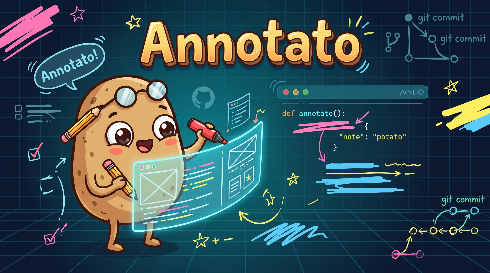

# Annotato — DoiT Cloud Intelligence Release Annotation Action

**Annotato** is a GitHub Action (`node24`) and CLI tool that automatically creates and manages timestamped annotations in [DoiT Cloud Intelligence](https://developer.doit.com/docs/annotations-api) (`/analytics/v1/annotations`) whenever you publish a GitHub release, deploy to production, or roll back a change.

By placing automated release markers directly on your DoiT Cloud Analytics cost and usage timelines, FinOps and engineering teams can immediately correlate cloud spend or utilization shifts with specific code releases and infrastructure changes.

---

## Table of Contents

1. [How It Works](#how-it-works)
2. [Step 1: Configure DoiT Cloud Intelligence](#step-1-configure-doit-cloud-intelligence)
   - [Create a DoiT API Token (Service Account vs. Personal Token)](#1-create-a-doit-api-token-service-account-vs-personal-token)
   - [Required DoiT Permissions](#2-required-doit-permissions)
   - [Finding DoiT Report IDs & Labels (Optional)](#3-finding-doit-report-ids--labels-optional)
3. [Step 2: Configure GitHub Secrets & Variables](#step-2-configure-github-secrets--variables)
4. [Step 3: Add Annotato to Your GitHub Workflows](#step-3-add-annotato-to-your-github-workflows)
   - [Example 1: Annotate Every Published GitHub Release](#example-1-annotate-every-published-github-release)
   - [Example 2: Annotate Production Deployments on Push to `main`](#example-2-annotate-production-deployments-on-push-to-main)
   - [Example 3: Update an Existing Annotation on Rollback](#example-3-update-an-existing-annotation-on-rollback)
   - [Example 4: Dry-Run Testing in Pull Requests](#example-4-dry-run-testing-in-pull-requests)
5. [Action Inputs Reference](#action-inputs-reference)
6. [Action Outputs Reference](#action-outputs-reference)
7. [Template Placeholders & Default Formatting](#template-placeholders--default-formatting)
8. [Label Resolution & Auto-Creation](#label-resolution--auto-creation)
9. [Local CLI Usage & Development](#local-cli-usage--development)
10. [Troubleshooting](#troubleshooting)
11. [Doers Only: Targeting a Customer with `X-Tenant-Id`](#doers-only-targeting-a-customer-with-x-tenant-id)

---

## How It Works

1. **Trigger**: Your GitHub Actions workflow runs on a `release`, `push`, `deployment_status`, `deployment`, or `workflow_dispatch` event.
2. **Context Extraction**: Annotato automatically reads the GitHub event payload and runner environment to extract the release version/tag, commit SHA, triggering actor, repository name, target environment, release/run URL, and RFC3339 event timestamp.
3. **Label Resolution (Optional)**: If you pass human-readable label names (e.g. `labels: 'production, release'`), Annotato queries `GET /analytics/v1/labels` to resolve them to DoiT label IDs—and if `create-missing-labels: 'true'` is enabled, automatically creates any missing labels via `POST /analytics/v1/labels`.
4. **DoiT Annotation API Call**: Annotato sends a request (`POST`, `PATCH`, `DELETE`, or `GET`) to `https://api.doit.com/analytics/v1/annotations` authenticated with `Authorization: Bearer <DOIT_API_KEY>`. Your DoiT customer account is inferred automatically from your API token.
5. **Outputs & Job Summary**: Annotato exposes the created annotation ID, content, timestamp, and JSON response as GitHub Action outputs and writes a formatted Markdown summary table to `$GITHUB_STEP_SUMMARY`.

---

## Step 1: Configure DoiT Cloud Intelligence

### 1. Create a DoiT API Token (Service Account vs. Personal Token)

Per the [DoiT API Getting Started Guide](https://developer.doit.com/docs/start), DoiT supports two types of API tokens. Your customer context is resolved automatically from your token:

| Token Type | Best For | How to Create in the DoiT Console |
| :--- | :--- | :--- |
| **Service Account API Token** *(Recommended for GitHub Actions)* | Shared CI/CD pipelines that should continue working even if an individual engineer changes roles or leaves your organization. | 1. Sign in to the [DoiT Console](https://app.doit.com/profile/api).<br>2. Click the **gear icon** (Settings) in the top navigation bar and select **Users and access**.<br>3. Select **Service Accounts** in the left-hand menu.<br>4. Select (or create) a service account and click **Create API token**. |
| **Personal API Token** | Individual testing, personal repositories, or scripts tied to your user account. | 1. Sign in to the [DoiT Console](https://app.doit.com/profile/api).<br>2. Click your **avatar** in the upper-right corner and select your name.<br>3. Open the **API** tab and click **Create API token**. |

> **Important Note on Service Accounts & Report Visibility**:
> Service accounts do not have a personal user email. If you attach annotations to specific reports using the `reports` input with a Service Account API token, those reports must be **shared organization-wide** or be **preset reports**. Private user-only reports are not accessible to service account tokens.

### 2. Required DoiT Permissions

Ensure the user or service account that owns the API token has the appropriate role/permissions in DoiT:
- **Create annotations (`operation: create`)**: Requires the **Cloud Analytics Admin** permission.
- **Update annotations (`operation: update`)**: Requires being the annotation owner or having the **Editor** permission.
- **Delete annotations (`operation: delete`)**: Requires being the annotation owner or having the **Cloud Analytics Admin** permission.

### 3. Finding DoiT Report IDs & Labels (Optional)

- **Report IDs (`reports` input)**:
  - If you omit `reports`, DoiT creates the annotation without report restrictions so it can be displayed across eligible Cloud Analytics reports.
  - To attach an annotation to specific Cloud Analytics reports, open the report in the DoiT Console (`https://console.doit.com/.../analytics/reports/<REPORT_ID>`) and copy the `<REPORT_ID>` (e.g., `HmqMNr1uIMQQySpiBWyt`). You can pass multiple report IDs separated by commas or newlines.
- **Labels (`labels` input)**:
  - You can pass either **human-readable label names** (e.g. `production, release`) or **raw DoiT label IDs** (e.g. `utHqK0OmwbPy1au3Xy22` or `id:utHqK0OmwbPy1au3Xy22`).

---

## Step 2: Configure GitHub Secrets & Variables

In your GitHub repository (or organization settings):

1. Navigate to **Settings → Secrets and variables → Actions**.
2. Under the **Secrets** tab, click **New repository secret**:
   - **Name**: `DOIT_API_KEY`
   - **Secret**: Paste your DoiT Service Account or Personal API token.
3. *(Optional)* Under the **Variables** tab, add:
   - `DOIT_REPORT_IDS`: Comma-separated list of DoiT Cloud Analytics report IDs (e.g., `HmqMNr1uIMQQySpiBWyt,2fhAJPvPz950syFUh0Zw`) if you want annotations scoped to specific reports by default.

---

## Step 3: Add Annotato to Your GitHub Workflows

### Example 1: Annotate Every Published GitHub Release

Create `.github/workflows/release-annotation.yml` (see [`examples/release-annotation.yml`](examples/release-annotation.yml)):

```yaml
name: Annotate Release in DoiT Cloud Intelligence

on:
  release:
    types: [published]

jobs:
  annotate-release:
    name: Create DoiT Release Annotation
    runs-on: ubuntu-latest
    steps:
      - name: Record Release on DoiT Cloud Analytics Timeline
        id: doit_annotation
        uses: ericethridge/annotato@main
        with:
          doit-api-key: ${{ secrets.DOIT_API_KEY }}
          reports: ${{ vars.DOIT_REPORT_IDS }}
          labels: 'production, release'
          create-missing-labels: 'true'
          label-color: 'blue'
          fail-on-error: 'false'

      - name: Print Created Annotation Details
        run: |
          echo "Created DoiT Annotation ID: ${{ steps.doit_annotation.outputs.annotation-id }}"
          echo "Timestamp: ${{ steps.doit_annotation.outputs.annotation-timestamp }}"
          echo "Content: ${{ steps.doit_annotation.outputs.annotation-content }}"
```

When you publish release `v2.4.0`, Annotato automatically creates an annotation at the release's `published_at` timestamp with content:
> `[owner/repo] Release v2.4.0 (a1b2c3d) published by @octocat`

---

### Example 2: Annotate Production Deployments on Push to `main`

Create `.github/workflows/deploy-annotation.yml` (see [`examples/deploy-annotation.yml`](examples/deploy-annotation.yml)):

```yaml
name: Deploy to Production & Annotate DoiT

on:
  push:
    branches: [main]

jobs:
  deploy-and-annotate:
    name: Deploy & Mark Cost Timeline
    runs-on: ubuntu-latest
    steps:
      - name: Checkout code
        uses: actions/checkout@v4

      - name: Deploy application to production
        run: echo "Deploying commit ${{ github.sha }} to production..."

      - name: Annotate Deployment in DoiT Cloud Intelligence
        id: annotate
        uses: ericethridge/annotato@main
        with:
          doit-api-key: ${{ secrets.DOIT_API_KEY }}
          release-id: 'prod-${{ github.sha }}'
          template: '🚀 [{repo}] Deployed {release} ({short_sha}) to {environment} by @{actor}'
          labels: 'production, deployment'
          create-missing-labels: 'true'
          label-color: 'teal'
          fail-on-error: 'false'
```

---

### Example 3: Update an Existing Annotation on Rollback

If a deployment fails verification or is rolled back, you can update the annotation created earlier in the workflow (or via manual `workflow_dispatch`) using `operation: 'update'` (see [`examples/rollback-annotation.yml`](examples/rollback-annotation.yml)):

```yaml
      - name: Update DoiT Annotation After Rollback
        if: failure() && steps.annotate.outputs.annotation-id != ''
        uses: ericethridge/annotato@main
        with:
          doit-api-key: ${{ secrets.DOIT_API_KEY }}
          operation: 'update'
          annotation-id: ${{ steps.annotate.outputs.annotation-id }}
          content: '⚠️ [{repo}] Deployment {release} ({short_sha}) ROLLED BACK by @{actor}'
          labels: 'production, rollback'
          create-missing-labels: 'true'
          label-color: 'rosePink'
```

---

### Example 4: Dry-Run Testing in Pull Requests

Use `dry-run: 'true'` to validate your template formatting and view the generated Markdown table in the GitHub Actions Job Summary without making any network calls to DoiT:

```yaml
      - name: Preview DoiT Annotation Payload (Dry Run)
        uses: ericethridge/annotato@main
        with:
          doit-api-key: 'dry-run-placeholder'
          dry-run: 'true'
          release-id: 'pr-${{ github.event.pull_request.number }}'
          labels: 'staging, preview'
```

---

## Action Inputs Reference

| Input | Required | Default | Env Fallback | Description |
| :--- | :---: | :---: | :---: | :--- |
| `doit-api-key` | **Yes** *(unless `dry-run: true`)* | — | `DOIT_API_KEY` | DoiT Cloud Intelligence API key (`Authorization: Bearer <key>`). Automatically masked in logs via `@actions/core.setSecret`. |
| `operation` | No | `create` | `INPUT_OPERATION` | Operation to execute against `/analytics/v1/annotations`: `create`, `update`, `delete`, `get`, or `list`. |
| `annotation-id` | Cond. | — | `INPUT_ANNOTATION_ID` | Target DoiT annotation ID. Required when `operation` is `update`, `delete`, or `get`. |
| `release-id` | No | Auto-detected | `INPUT_RELEASE_ID` | Explicit release version/identifier (overrides the auto-detected GitHub release name/tag or branch ref). |
| `content` | No | Auto-formatted | `INPUT_CONTENT` | Explicit annotation text shown on DoiT reports. Supports [template placeholders](#template-placeholders--default-formatting). |
| `template` | No | Event default | `INPUT_TEMPLATE` | Custom template string used when `content` is not set. Supports [template placeholders](#template-placeholders--default-formatting). |
| `timestamp` | No | Event timestamp | `INPUT_TIMESTAMP` | Explicit ISO-8601 / RFC3339 date-time (e.g., `2026-10-21T14:05:00Z`). Defaults to `release.published_at`, `head_commit.timestamp`, `deployment_status.updated_at`, or current UTC time. |
| `reports` | No | `""` | `INPUT_REPORTS` | Comma- or newline-separated list of DoiT Cloud Analytics report IDs to attach the annotation to. |
| `labels` | No | `""` | `INPUT_LABELS` | Comma- or newline-separated list of DoiT label names or label IDs to associate with the annotation. |
| `create-missing-labels` | No | `false` | `INPUT_CREATE_MISSING_LABELS` | When `true`, automatically creates any label names not yet found in DoiT via `POST /analytics/v1/labels`. |
| `label-color` | No | `blue` | `INPUT_LABEL_COLOR` | Color used when creating missing labels. Allowed values: `blue`, `skyBlue`, `teal`, `mint`, `lime`, `softYellow`, `apricot`, `lavender`, `purple`, `rosePink`, `slateGrey`. |
| `api-url` | No | `https://api.doit.com` | `DOIT_API_URL` | Base URL for the DoiT Cloud Intelligence API. |
| `filter` | No | — | `INPUT_FILTER` | Filter expression when `operation` is `list` (e.g. `content:Release\|labels:production`). |
| `max-results` | No | — | `INPUT_MAX_RESULTS` | Maximum number of annotations to return when `operation` is `list`. |
| `dry-run` | No | `false` | `INPUT_DRY_RUN` | When `true`, builds the request payload, sets outputs, and writes the Job Summary without calling the DoiT API. |
| `fail-on-error` | No | `true` | `INPUT_FAIL_ON_ERROR` | When `false`, logs a warning (`::warning::`) instead of failing the workflow step if the DoiT API returns an error. |
| `tenant-id` | No | — | `DOIT_TENANT_ID` | *(Doers Only)* Optional Customer/Tenant ID sent via the `X-Tenant-Id` header. Customers do not need to set this. See [Doers Only](#doers-only-targeting-a-customer-with-x-tenant-id). |

---

## Action Outputs Reference

| Output | Description |
| :--- | :--- |
| `annotation-id` | The unique DoiT ID (`id`) of the created, updated, retrieved, or deleted annotation (or first item on `list`). |
| `annotation-content` | The final rendered `content` string sent to or returned by DoiT. |
| `annotation-timestamp` | The normalized RFC3339 UTC `timestamp` string (e.g., `2026-10-21T16:20:00.000Z`). |
| `annotation-json` | Full JSON string of the DoiT API response object (or request payload when `dry-run: true`). |

---

## Template Placeholders & Default Formatting

If you do not provide `content` or `template`, Annotato formats the annotation automatically based on the triggering GitHub event:

| GitHub Event (`GITHUB_EVENT_NAME`) | Default Annotation Format | Default Timestamp Source |
| :--- | :--- | :--- |
| `release` | `[{repo}] Release {release} ({short_sha}) published by @{actor}` | `release.published_at` (or `release.created_at`) |
| `deployment_status` / `deployment` | `[{repo}] Deployed {release} ({short_sha}) to {environment} by @{actor}` | `deployment_status.updated_at` (or `deployment.created_at`) |
| `push` | `[{repo}] Push {release} ({short_sha}) to {environment} by @{actor}` | `head_commit.timestamp` |
| `workflow_dispatch` / other | `[{repo}] Release {release} ({short_sha}) ({event}) by @{actor}` | Current UTC timestamp (`new Date().toISOString()`) |

You can customize `content` or `template` using any combination of these placeholders:

- `{repo}` — Repository full name (`owner/repo`)
- `{release}` — Resolved release identifier (`release-id` input, release name/tag, deployment ref, or branch name)
- `{tag}` — Git tag or ref name (`v1.2.0`, `main`, etc.)
- `{sha}` — Full 40-character commit SHA
- `{short_sha}` — 7-character short commit SHA
- `{actor}` — GitHub username that triggered the workflow
- `{event}` — GitHub event name (`release`, `push`, `deployment_status`, `workflow_dispatch`)
- `{environment}` — Deployment environment name (defaults to `production` or `ENVIRONMENT` env var)
- `{url}` — Release HTML URL, commit URL, deployment target URL, or workflow run URL
- `{timestamp}` — Normalized RFC3339 UTC timestamp

---

## Label Resolution & Auto-Creation

DoiT's `POST /analytics/v1/annotations` endpoint expects an array of **label IDs**. Annotato makes working with labels effortless:

1. **Lookup by Label Name**: When you specify `labels: 'production, release'`, Annotato calls `GET /analytics/v1/labels?nameContains=<label>` and matches existing label names case-insensitively (`Production` -> `lbl_id`).
2. **Auto-Creation (`create-missing-labels: 'true'`)**: If a label name does not exist yet in DoiT and `create-missing-labels` is `'true'`, Annotato creates it via `POST /analytics/v1/labels` with the configured `label-color` (default `'blue'`) and attaches the newly created label ID.
3. **Direct Label IDs**:
   - Prefix any label with `id:` (e.g., `labels: 'id:utHqK0OmwbPy1au3Xy22'`) to bypass label lookup and send the ID directly.
   - If `create-missing-labels` is `'false'` (default) and no label name matches your input, Annotato passes the value through as a raw label ID.

---

## Local CLI Usage & Development

You can also run Annotato directly from your terminal or any CI system using Node.js 20+ / 24+:

```bash
# Install dependencies
npm install

# Run TypeScript typechecking, bundle dist/index.js, and execute the test suite
npm run verify

# Run locally in dry-run mode
DOIT_API_KEY="test-key" \
INPUT_DRY_RUN="true" \
INPUT_RELEASE_ID="v1.2.3" \
GITHUB_REPOSITORY="my-org/my-service" \
GITHUB_EVENT_NAME="release" \
GITHUB_SHA="a1b2c3d4e5f60000" \
GITHUB_ACTOR="alice" \
node dist/index.js

# Create a live DoiT annotation from the CLI
DOIT_API_KEY="your-live-doit-api-key" \
INPUT_RELEASE_ID="v1.2.3" \
INPUT_LABELS="production,release" \
INPUT_CREATE_MISSING_LABELS="true" \
GITHUB_REPOSITORY="my-org/my-service" \
GITHUB_EVENT_NAME="release" \
node dist/index.js
```

---

## Troubleshooting

| Symptom / HTTP Status | Cause | Solution |
| :--- | :--- | :--- |
| **`401 Unauthorized`** | Invalid, expired, or missing DoiT API token. | Verify that `secrets.DOIT_API_KEY` is set in your repository's **Settings → Secrets and variables → Actions** and contains a valid token from [https://app.doit.com/profile/api](https://app.doit.com/profile/api). |
| **`403 Forbidden`** when creating or deleting annotations | API token lacks sufficient permissions. | Ensure the user or service account owns the **Cloud Analytics Admin** permission in DoiT Cloud Intelligence. |
| **`404 Not Found` / Report not found** when using a Service Account | Target report in `reports` is a private user report. | Service accounts have no user email and can only access **preset reports** or reports **shared organization-wide** in DoiT Cloud Analytics. Share the report with your organization in the DoiT Console. |
| **Workflow fails during DoiT maintenance** | `fail-on-error` defaults to `'true'`. | Set `fail-on-error: 'false'` in your workflow step so annotation errors are logged as GitHub warnings without blocking your deployment pipeline. |

---

## Doers Only: Targeting a Customer with `X-Tenant-Id`

> **Note for Customers**: You can skip this section. Standard customer Personal API tokens and Service Account tokens are automatically scoped to your DoiT organization—you never need to provide a Tenant ID.

If you are a **Doer** (DoiT employee, CRE, TAM, or Solutions Architect) or operating an internal DoiT multi-tenant token that needs to create or manage annotations on behalf of a specific customer tenant, you must pass the customer's Tenant ID so Annotato sends the `X-Tenant-Id` HTTP header.

### Finding the Customer Tenant ID
1. Open the customer's account in the [DoiT Console](https://console.doit.com/).
2. Copy the Tenant / Customer ID from the console URL path following `/customers/<TENANT_ID>/...` (for example: `https://console.doit.com/customers/12345abcde/analytics/reports`).

### Configuring `X-Tenant-Id` in GitHub Actions or CLI

Always authenticate with `Authorization: Bearer <token>` (`doit-api-key`) **in addition to** setting the Tenant ID. (`X-Tenant-Id` supersedes the legacy `customerContext` query parameter, which is ignored by personal and service account tokens.)

1. **Via the Action `tenant-id` input**:
   ```yaml
   - name: Annotate Release for Customer Tenant
     uses: ericethridge/annotato@main
     with:
       doit-api-key: ${{ secrets.DOIT_API_KEY }}
       tenant-id: ${{ vars.DOIT_TENANT_ID }} # Sends header: X-Tenant-Id: <TENANT_ID>
       reports: ${{ vars.DOIT_REPORT_IDS }}
       labels: 'production, release'
       create-missing-labels: 'true'
   ```
2. **Via the `DOIT_TENANT_ID` environment variable**:
   ```yaml
   - name: Annotate Release for Customer Tenant
     uses: ericethridge/annotato@main
     env:
       DOIT_API_KEY: ${{ secrets.DOIT_API_KEY }}
       DOIT_TENANT_ID: ${{ vars.DOIT_TENANT_ID }}
   ```
3. **Via the local CLI**:
   ```bash
   DOIT_API_KEY="your-doer-api-key" \
   DOIT_TENANT_ID="target-customer-tenant-id" \
   INPUT_RELEASE_ID="v1.2.3" \
   GITHUB_REPOSITORY="customer-org/app" \
   GITHUB_EVENT_NAME="release" \
   node dist/index.js
   ```
